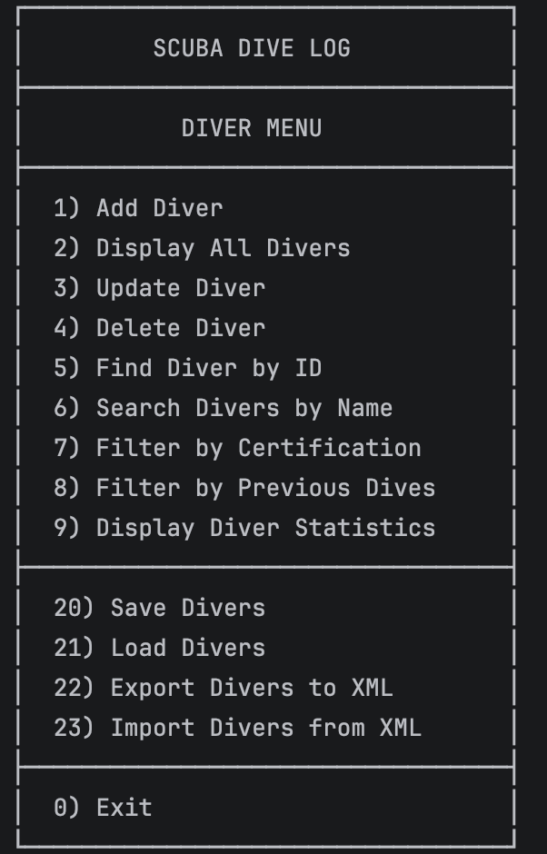

# 🤿 Scuba Dive Log App

### A Kotlin Console Application for Scuba Diver Management

Developed for the **Software Development Tools** module at  
**South East Technological University (SETU)**.

---

## About the Project

**Scuba Dive Log** is a Kotlin console application developed as part of the Software Development Tools module at South East Technological University (SETU).

The application allows users to manage scuba diver records, including personal details, diving certifications and previous diving experience.

The project currently supports:

- CRUD operations for diver management
- JSON and XML data persistence
- Searching and filtering diver records
- Diver statistics and reporting
- Input validation and error handling
- Automated testing using JUnit 5

The project demonstrates an iterative software development approach, incorporating version control, automated testing, data persistence and structured application design.

---

## Features

### Diver Management
- Add and display registered divers
- Find divers by their unique ID
- Update individual diver details
- Delete existing divers
- Automatically generate unique diver IDs

### Search and Filtering
- Search divers by full or partial name
- Perform case-insensitive searches
- Filter divers by certification
- Filter divers by minimum previous dive count

### Diver Statistics
- View the total number of registered divers
- Count divers by certification
- Identify experienced divers with 100 or more previous dives

### Data Persistence
- Save and load diver records using JSON
- Export and import diver records using XML
- Preserve diver IDs when loading saved records
- Automatically calculate the next available ID after importing data

### Input Validation
- Validate diver names, dates of birth, emails and certifications
- Prevent negative previous dive counts
- Handle invalid menu choices and user input
- Log application startup and exit

---

## Technologies Used

| Technology | Purpose |
|---|---|
| **Kotlin** | Main programming language |
| **Gradle** | Build automation and dependency management |
| **JUnit 5** | Automated unit testing (49 passing tests) |
| **Jackson** | JSON and XML data persistence |
| **Kotlin Logging & SLF4J** | Application logging |
| **IntelliJ IDEA** | Development environment |
| **Git & GitHub** | Version control and project management |

---

## Getting Started

### Prerequisites

- IntelliJ IDEA
- JDK 26

### Running the Application

1. Clone or download this repository.
2. Open the project in IntelliJ IDEA.
3. Allow Gradle to synchronise the dependencies.
4. Run `Main.kt`.
5. Follow the instructions displayed in the console.

---

## Application Preview

The application provides an interactive console menu for managing scuba divers, searching records, viewing statistics and saving data.

  

---

## Testing

The application includes **49 automated JUnit 5 tests**, all passing successfully.

### Automated Testing

The tests cover:

- Adding, retrieving, updating and deleting divers
- Finding divers by unique ID
- Searching divers by name
- Filtering by certification and previous dives
- Diver statistics and counting methods
- JSON and XML persistence
- Replacing diver records and maintaining unique IDs
- Empty collections, invalid IDs and boundary values

**Test Results: 49 passed, 0 failed.**

To run the tests, open `DiverServiceTest.kt` in IntelliJ IDEA and run the test class.

### Manual Testing

The console menu, CRUD operations and input validation have also been manually tested using valid and invalid inputs.

---

## Project Structure

The application separates diver data, business logic, persistence and user interaction into different components.

| File | Responsibility |
|---|---|
| `Main.kt` | Console menu and application flow |
| `Diver.kt` | Diver data model |
| `DiverService.kt` | CRUD operations, searching, filtering and statistics |
| `UserInput.kt` | User input validation |
| `Serializer.kt` | Persistence interface |
| `JSONSerializer.kt` | JSON saving and loading |
| `XMLSerializer.kt` | XML importing and exporting |
| `DiverServiceTest.kt` | Automated JUnit tests |

---

## Development & Version History

This project follows an iterative development approach using GitHub Issues, feature branches, meaningful commits and Pull Requests.

### V1.0.0 — Diver Management

- Implemented CRUD operations for divers
- Added automatic unique diver IDs
- Introduced input validation
- Created the console menu and application logging

### V2.0.0 — Persistence, Search & Testing

- Added JSON and XML data persistence
- Improved diver update functionality
- Implemented searching and filtering
- Added diver statistics
- Created 49 automated JUnit tests

---

## Author

**Arijus**

Software Development student at **South East Technological University (SETU)**.

This project combines my interest in software development with my experience in scuba diving.

**GitHub:** [baltic-spearo](https://github.com/baltic-spearo)

---
